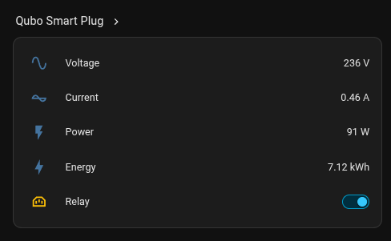

# Qubo 10A smart plug — local BLE control for Home Assistant



Control and meter a Qubo HSP02 smart plug over Bluetooth, with no Qubo account, no app and no
internet. A small Python daemon on any Linux box with a Bluetooth adapter talks to the plug directly
and bridges it to Home Assistant over MQTT.

```
qubo_poller.py  --BLE-->  plug
      |
      +--MQTT-->  Home Assistant  (switch, V, A, W, kWh)
```

Tested on `HSP02_01_01_14_SYSTEM-10A`, which advertises as `*QBO_P_<MAC without colons>`. The plug is
an ESP32 (MAC OUI `3C:0F:02`).

## What you need

- Linux with BlueZ 5.60 or newer, adapter within a few metres of the plug.
- `python-dbus` and `python-gobject` from the distro. The poller uses BlueZ over D-Bus, not `bleak`.
- An MQTT broker and Home Assistant. The poller publishes its own discovery.
- No Qubo account, and no internet on the plug.

## 1. Find the plug

```bash
bluetoothctl --timeout 15 scan on >/dev/null
bluetoothctl devices | grep QBO_P
```

The name is `*QBO_P_<MAC without colons>`; the address is the same digits with colons.

## 2. Python environment

The D-Bus module belongs to the distro Python, so the venv must use that interpreter and see system
packages:

```bash
uv venv --python /usr/bin/python3 --system-site-packages .venv
uv pip install --python .venv/bin/python paho-mqtt cryptography
```

## 3. Install a key (one time)

Out of the box the plug holds a `securityKey` from its previous commissioning and ignores every relay
command that is not encrypted with it. A factory reset does not clear it. This step installs a key you
choose. Nothing leaves your network: the plug is only told a 2.4 GHz SSID, a password and the key.

1. Hold the power button ~10 s until the LED blinks fast. That is pairing mode (`dd03` reads `S_01`); the
   script refuses to run otherwise.
2. Using any 2.4 GHz network the plug can join (a phone hotspot is fine):

```bash
.venv/bin/python research/provision.py --ssid "<SSID>" --password "<password>"
```

The plug reboots to join Wi-Fi, then commits the key, and the script retests the relay. Success looks
like:

```
relay dd02  : 1 -> 0   *** WORKS ***
```

If it reports `S_01` again, the Wi-Fi join failed (wrong band or password, or 2.4 GHz is disabled).
Fix that and hold the button again. The key is only stored after a successful join.

The default key is `ABCDEFGHIJKLMNOP`. Use `--key` for a different 16-character key and pass the same
value to the poller with `--ble-key`.

## 4. Run the poller

```bash
.venv/bin/python qubo_poller.py --stdout          # one-shot check, no MQTT
.venv/bin/python qubo_poller.py --relay off       # flip the relay once and exit
```

As a user service:

```bash
mkdir -p ~/.config/systemd/user
cp qubo-poller.service ~/.config/systemd/user/
systemctl --user daemon-reload
systemctl --user enable --now qubo-poller
journalctl --user -u qubo-poller -f
```

The unit expects the repo at `~/qubo10a-plug-firmware`; edit `WorkingDirectory` and `ExecStart` if it
lives elsewhere.

## 5. Home Assistant

Nothing to configure if the MQTT integration already exists. The poller publishes retained discovery for
one device with five entities:

| Entity | Topic |
| --- | --- |
| `switch.qubo_smart_plug_relay` | `qubo/<mac>/set` (`ON`/`OFF`) |
| `sensor.qubo_smart_plug_voltage` / `_current` / `_power` | `qubo/<mac>/state` |
| `sensor.qubo_smart_plug_energy` (kWh, `total_increasing`) | `qubo/<mac>/state` |

The device also publishes `qubo/<mac>/availability`, republished on every MQTT reconnect.

Energy is integrated from power inside the poller and stored in `~/.local/state/qubo-poller/energy.json`.
It is deliberately not read from the plug's own counters, which reset on provisioning and do not agree
with each other. Gaps longer than three poll intervals are skipped so downtime cannot inflate the total.

## Keeping it off the internet

Stock firmware has no local Wi-Fi API. On Wi-Fi the plug only opens an outbound MQTT/TLS connection to
the vendor cloud, so local control is always BLE. Joining a network is still worth doing: it stops the
plug retrying Wi-Fi every 30 s and keeps the BLE link stable.

With the key installed there are no cloud tokens on the plug, so it cannot authenticate to the vendor.
To be certain nothing leaves, block its MAC at the router or put it on an isolated VLAN with no internet,
after provisioning. `dd03` then reads `E_05` (cloud rejected) rather than `\0\0\0\0` (Wi-Fi lost).

## Troubleshooting

| Symptom | Cause | Fix |
| --- | --- | --- |
| Relay never changes, telemetry fine | wrong key | re-provision (step 3) |
| `dd03` = `S_01` | pairing mode | expected during step 3 |
| `dd03` = `E_05` | joined Wi-Fi, cloud auth failed | harmless, no account is used |
| `dd03` = `\0\0\0\0` | no Wi-Fi | BLE still works, link blips every ~30 s |
| Link drops every ~30 s | plug retrying an absent network | give it a reachable 2.4 GHz network |
| Connects then drops in ~1 s, repeats | stale bond after the plug rebooted | `bluetoothctl remove <MAC>`; bonding is not needed |
| Switch missing in HA | stale retained discovery with a duplicate `unique_id` | `mosquitto_pub -t '<old topic>' -r -n`, restart the poller |
| Voltage sensor errors in the HA log | template returned the string `'unknown'` | fixed here; keep the JSON `null` |

## Limits

- One poller process per plug. The adapter handles about seven concurrent BLE links, so four to six plugs
  per dongle. Change `client_id` before running more than one instance.
- BLE range is the real limit. A second dongle or a host nearer the plugs beats a longer antenna.
- The telemetry is uncalibrated. A load test against a known resistive load is still worth doing.
- The vendor APK is not in this repo. It is only needed to re-derive the protocol; the results are in
  `FINDINGS.md`.

## Legal and safety

Not affiliated with Qubo or Hero Electronix; those names are used only to describe the hardware. This
repo contains no vendor binaries or decompiled vendor source, and no cloud credentials. Protocol
details were derived for interoperability with hardware the author owns. Use it only on devices you own
and only where local law allows it.

Flashing or opening the plug is a mains-safety matter, not just a warranty matter. The board is
non-isolated: DC ground sits at mains potential. Never connect a USB-UART adapter while the plug is in a
socket, and power it only from an isolated 3.3 V supply.

## Files

| File | Purpose |
| --- | --- |
| `qubo_poller.py` | poller, relay frame, MQTT bridge |
| `research/provision.py` | installs a known `securityKey` over `ee01` |
| `research/relay_matrix.py` | negative matrix that ruled out frame-shape hypotheses |
| `research/relay_probe.py`, `relay_variants.py` | low-level write diagnostics |
| `extract_key.py` | unused cloud-key helper (needs an account; not part of this path) |
| `FINDINGS.md` | protocol reference and what did not work |
| `AGENTS.md` | environment and operational notes |
